# Руководство пользователя. Настольный клиент

Документ для мастера участка и бригады, которые каждый день работают с
заявками на ремонт и техническое обслуживание. Описывает настольный
клиент — окна программы, а не веб-версию: для руководителя есть отдельное
руководство, `docs/user-guide-web.md`.

---

## 1. Что это за программа

«ТОиР-Проф» — учёт технического обслуживания и ремонта оборудования.
Программа показывает график ТО, заявки на ремонт, состав бригад и остатки
материалов на складе. Она работает через общий сервер, поэтому данные,
введённые мастером, сразу видны руководителю.

Программа состоит из восьми окон:

| Окно | Для чего | Кому доступно |
|------|----------|---------------|
| Авторизация | Вход в систему | всем |
| Дашборд мастера | Ключевые цифры участка за период | всем |
| Оборудование цеха | Реестр единиц техники, карточка, статус | всем |
| График ТО | Плановые работы, отметка выполнения | всем |
| Заявки | Заявки на ремонт и весь их жизненный цикл | всем |
| Бригады | Состав и загрузка бригад | руководителю, администратору |
| Материалы и ЗИП | Складской учёт, приход | руководителю, администратору |
| Отчёты | Аналитика, сводные отчёты, ссылка на PDF | руководителю, администратору |

Если в меню нет нужного окна, значит у вашей учётной записи нет таких прав.
Это не ошибка: за состав бригад и склад отвечает руководитель.

---

## 2. Запуск и первый вход

### 2.1. Запуск

1. Откройте папку с программой и запустите файл `ToirProf.Desktop`.
2. Через несколько секунд откроется окно ввода логина.

### 2.2. Вход

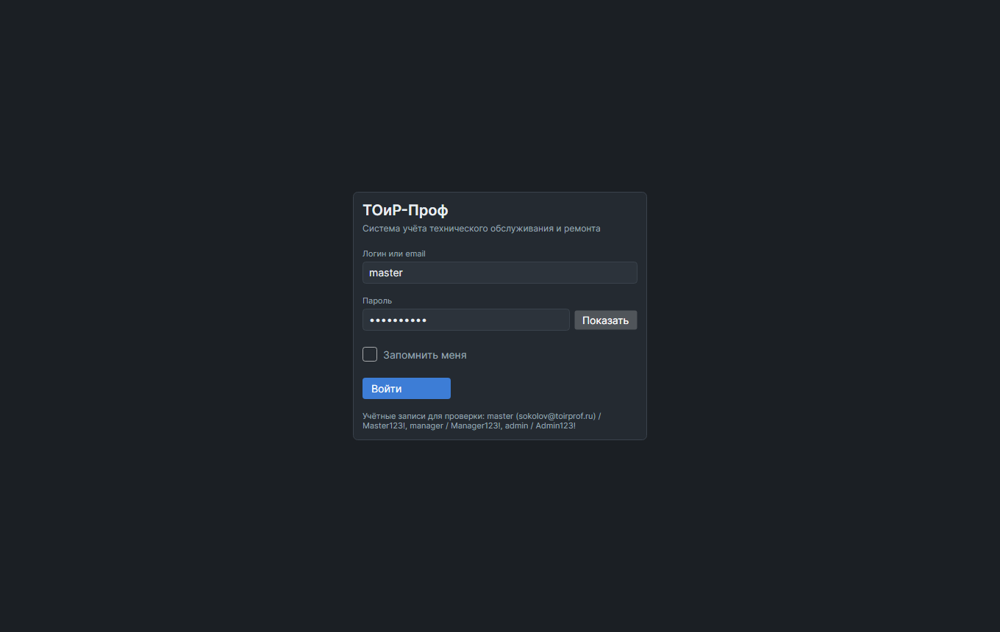

В поле **Логин или email** можно ввести и логин, и адрес почты
(например, `sokolov@toirprof.ru` для мастера). Если в поле есть символ
`@`, программа сразу проверяет формат адреса и подсвечивает ошибку под
полем. Введите логин и пароль, выданные администратором:

| Логин | Пароль | Кто это |
|-------|--------|---------|
| `master` | `Master123!` | Мастер участка |
| `manager` | `Manager123!` | Руководитель цеха |
| `admin` | `Admin123!` | Администратор системы |

Пароль не показывается — вместо символов видны точки. Кнопка **Показать**
справа от поля временно открывает пароль, чтобы проверить, что он набран
верно. Нажмите **Войти** (или Enter).

**Запомнить меня.** Если отметить флажок, программа сохранит вход на этом
компьютере: при следующем запуске она проверит токен на сервере
(`GET /api/auth/me`) и откроет дашборд без пароля. Без флажка токен
хранится только в памяти и забывается при закрытии программы. Флажок
меняется и в окне **Настройки**.

Если подсказка внизу окна показывает демонстрационные учётные записи,
это значит, что система работает на тестовом наборе данных.

### 2.3. Автоблокировка

**После ошибок входа.** После трёх неудачных попыток форма блокируется на
15 секунд. Под полями входа появится плашка с обратным отсчётом. Дождитесь,
пока она исчезнет, и попробуйте снова. Это защита от перебора паролей.

**При бездействии.** Если 15 секунд не двигать мышью и не нажимать клавиши,
экран закрывается плашкой «Экран заблокирован». Данные под ней не видны.
Введите свой пароль и нажмите **Разблокировать** — работа продолжится с
того же места. Кнопка **Выйти** завершает сеанс. Заблокировать экран
вручную — кнопка **Блокировать** в верхней панели или **Ctrl+L**.
Пока открыто модальное окно (форма заявки, карточка), экран не
блокируется. Время блокировки меняется в **Настройках**: 15 секунд,
1 минута, 5 минут или «не блокировать».

### 2.4. Что делать, если не получается войти

| Сообщение | Что означает | Что делать |
|-----------|-------------|------------|
| Неверный логин (email) или пароль | Ответ 401: логина нет или пароль не подходит | Проверьте раскладку клавиатуры, попросите новый пароль у администратора |
| Неверный формат email | В поле есть `@`, но адрес записан с ошибкой | Исправьте адрес или введите логин |
| Ошибка на сервере | Ответ 500 | Повторите позже, сообщите администратору |
| Учётная запись отключена | Сотрудник уволен или учётная запись погашена | Обратитесь к администратору |
| Нет связи с сервером | Программа не видит API | Проверьте, запущен ли сервер; при отладке — адрес в настройках |
| Слишком много попыток | Сработала автоблокировка | Подождите 15 секунд |

### 2.5. Выход

Кнопка **Выход** в правом верхнем углу. Программа вернётся на экран входа и
забудет токен, — следующий пользователь войдёт под своим логином.

---

## 3. Оболочка программы

Окно разделено на четыре части.

**Боковое меню** — слева. Пункты, доступные вашей роли, показываются
всегда; недоступные скрыты, чтобы вы не нажимали на кнопку, которая
вернёт ошибку.

**Верхняя панель** — по центру сверху. На ней видно, кто вошёл, какая роль
у сотрудника, есть ли связь с сервером и сколько операций ждёт отправки.
Кнопки на панели:

- **Уведомления · N** — лента последних событий по заявкам и оборудованию
  (создание, смена статуса, закрытие). Число — сколько событий вы ещё не
  видели; программа опрашивает сервер раз в 30 секунд и показывает новое
  событие всплывающим сообщением. Открытие ленты сбрасывает счётчик.
- **Настройки** — размер шрифта, строк на странице (25, 50 или 100),
  время автоблокировки и «Запомнить меня». Настройки хранятся в
  `%LOCALAPPDATA%\ToirProf\settings.json` вместе с размером окна и
  шаблонами отчётов и действуют после перезапуска.
- **Блокировать**, **Обновить** и **Выход**.

**Модальные окна ошибок.** Если операция не прошла из-за связи, прав или
ошибки сервера, программа показывает окно с объяснением и предложением,
что сделать: войти заново (401), обратиться к руководителю (403),
обновить список (404, 409), проверить, запущен ли сервер (нет связи),
или нажать **Повторить**. Ошибки заполнения формы показываются прямо в
форме красным списком.

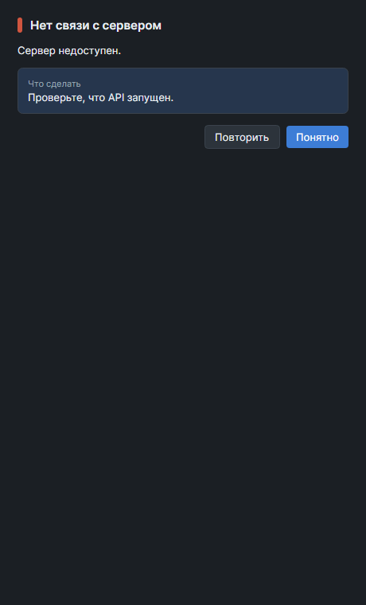

**Хлебные крошки** — под верхней панелью. Показывают, где вы находитесь:
например, «Цех → Оборудование цеха». По ним легко вернуться на один уровень
вверх.

**Полоса загрузки** — тонкая полоса под крошками. Если она появляется,
программа запрашивает данные; исчезает — данные получены.

**Горячие клавиши** (список — по **F1** или кнопке внизу меню):

| Клавиши | Действие |
|---------|----------|
| Ctrl+1 … Ctrl+7 | Экраны по порядку меню: дашборд, оборудование, график ТО, заявки, бригады, материалы, отчёты |
| Ctrl+N | Новая аварийная заявка с любого экрана |
| Ctrl+L | Заблокировать экран |
| F5 или Ctrl+R | Обновить открытый экран |
| Ctrl+, | Настройки |
| Esc | Закрыть модальное окно |

---

## 4. Дашборд мастера

Первый экран после входа. Отвечает на вопрос «что происходит на участке».
Данные обновляются сами каждые 60 секунд — время последнего обновления
написано под карточками.

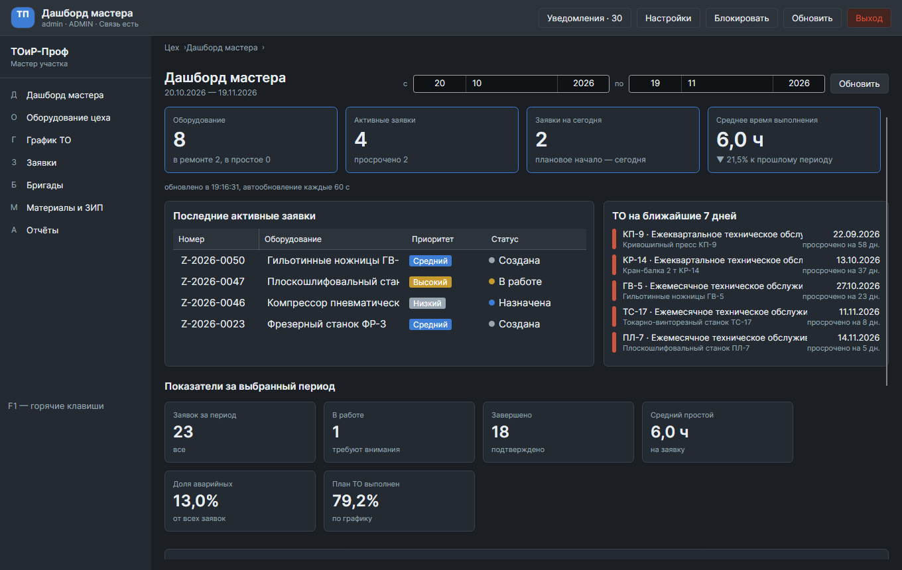

**Четыре ключевых показателя** (сверху, крупно):

| Карточка | Что показывает |
|----------|----------------|
| Оборудование | Сколько единиц в парке, сколько из них в ремонте и в простое |
| Активные заявки | Заявки в работе, назначенные и ожидающие материалов; сколько просрочено |
| Заявки на сегодня | Заявки с плановым началом на сегодня |
| Среднее время выполнения | Часов от начала до окончания работ; стрелка — изменение к прошлому периоду |

**Последние активные заявки** — десять свежих заявок, которые ещё не
закрыты. Цвет плашки приоритета: красный — критический, жёлтый — высокий,
синий — средний, серый — низкий. Точка перед статусом окрашена по статусу.

**ТО на ближайшие 7 дней** — плановые работы на неделю вперёд и
просроченные: красная полоса — срок прошёл, жёлтая — до срока три дня
и меньше, зелёная — время есть.

**Выбор периода.** Два поля даты: «с» и «по». По умолчанию — последние 30
дней. Кнопка **Обновить** применяет период. Заголовок справа показывает
подпись выбранного периода.

**Показатели за выбранный период** — шесть карточек ниже:

| Карточка | Что показывает | На что смотреть |
|----------|----------------|-----------------|
| Заявок за период | Сколько заявок создано, сколько завершено, сколько в работе | Если «в работе» растёт неделями — бригады не успевают |
| Средний простой | Часов на одну завершённую заявку | Рост означает, что поломки стали сложнее |
| Доля аварийных | Процент аварийных заявок | Красная карточка — больше 15 %, стоит разобраться с причинами |
| Выполнение плана ТО | Доля выполненных плановых работ | Ниже 80 % — график ТО срывается |
| Списано материалов | Сумма по всем завершённым работам | Неожиданный рост — ищите дорогие позиции в заявках |
| Цехов в работе | Сколько цехов давали заявки и сколько заявок в каждом | Пусто означает, что период выбран неверно |

**Три таблицы** под карточками: заявки по цехам, статусы заявок и динамика
по месяцам. Если таблица пустая, либо за выбранный период нет данных, либо
период задан неверно — проверьте даты «с» и «по».

---

## 5. Оборудование цеха

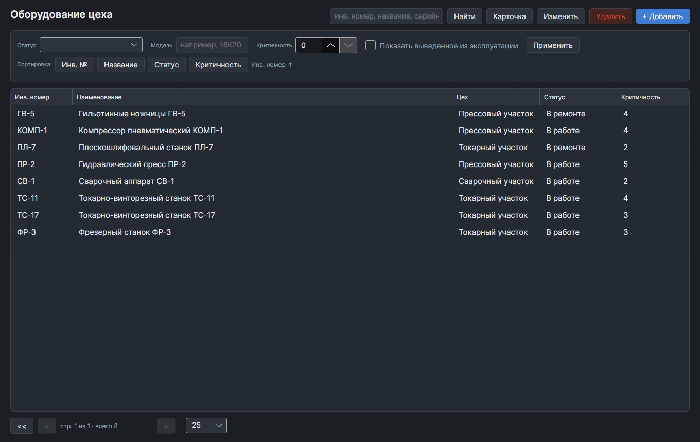

Мастер видит только оборудование своего цеха — это ограничение сервера.

### 5.1. Поиск и фильтры

- **Поиск** — поле ввода и кнопка **Найти** (работает и клавиша Enter).
  Ищет по инвентарному номеру, названию и серийному номеру.
- **Цех** — список для сужения выборки.
- **Статус** — «В работе», «В ремонте», «В простое» или «Выведено из
  эксплуатации». Статусы «В ремонте» и «В работе» ставятся автоматически:
  когда по оборудованию начинают работу и когда её завершают.
- **Критичность от** — от 1 до 5. Чем выше критичность, тем дороже простой
  оборудования при поломке.
- **Модель** — фильтр по модели, например `16К20`.
- **Показывать выведенное из эксплуатации** — по умолчанию выключено:
  выведенная техника не должна попадать в рабочие списки.
- **Сортировка** — кнопки «Инв. №», «Название», «Статус», «Критичность».
  Повторное нажатие меняет направление; текущая сортировка подписана
  справа (например, «Инв. номер ↑»).

### 5.2. Таблица

Колонки: инвентарный номер, название, цех, статус, критичность. Внизу —
постраничная навигация: «В начало», «Назад», «Вперёд» и выбор размера
страницы.

### 5.3. Карточка оборудования

Дважды щёлкните строку таблицы (или выберите строку и нажмите
**Карточка**) — откроется окно с тремя вкладками:

- **Основная информация** — цех, статус, критичность, изготовитель,
  модель, серийный номер, даты ввода в эксплуатацию, ввода в работу и
  списания, место установки, примечание;
- **История заявок** — все заявки по единице: номер, дата, тип,
  приоритет, статус, простой, бригада;
- **История ТО** — плановые записи: вид ТО, плановая и фактическая даты,
  статус, стоимость.

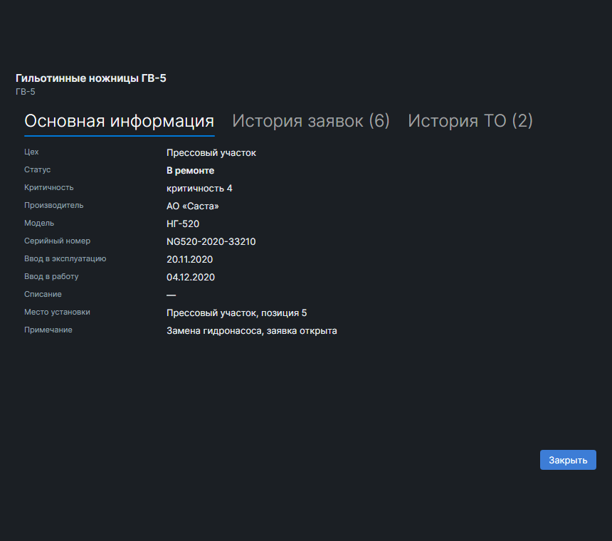

### 5.4. Добавление, изменение и удаление

- **+ Добавить** (администратор) — форма новой единицы. Обязательны
  инвентарный номер, название, цех и дата ввода в эксплуатацию.
- **Изменить** (администратор, руководитель) — та же форма с заполненными
  полями; инвентарный номер не меняется.
- **Удалить** (администратор) — программа спрашивает подтверждение и
  предупреждает о последствиях. Если по оборудованию уже есть заявки или
  график ТО, сервер не даст удалить запись — такое оборудование выводят из
  эксплуатации, а не удаляют.

Форма проверяет даты до отправки: ввод в работу — не раньше ввода в
эксплуатацию и не позже сегодняшнего дня; дата списания — строго позже
ввода в эксплуатацию. Ошибки показываются красным списком внизу формы.

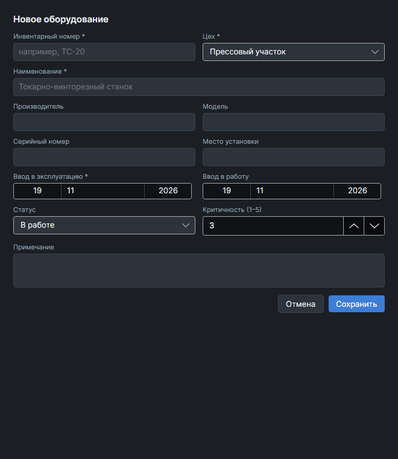

**Смена статуса.** Статус меняется в форме **Изменить**.

> **Важно.** У оборудования, выведенного из эксплуатации, статус
> изменить нельзя — программа и сервер откажут. Это правило задано
> триггером в базе данных и сделано специально: выведенную технику нельзя
> снова ввести в работу. Остальные поля карточки при этом редактируются
> обычно.

Если при смене статуса выводится сообщение об ошибке, прочитайте его
целиком — там написано, что именно не так.

---

## 6. График технического обслуживания

### 6.1. Календарь

Экран открывается на вкладке **Календарь** — сетка текущего месяца.
Кнопки **<** и **>** листают месяцы, **Сегодня** возвращает к текущему.
Каждая запись графика — цветная плашка «инв. номер · вид ТО» в ячейке
плановой даты:

| Цвет | Значение |
|------|----------|
| Красный (и красная ячейка) | Просрочено: дата прошла, ТО не выполнено |
| Жёлтый (и жёлтая ячейка) | Плановая дата в ближайшие 3 дня |
| Зелёный | Выполнено |
| Синий | Запланировано, по записи уже создана заявка |

Над сеткой — счётчики «просрочено» и «ближайшие 3 дня». Сегодняшний день
обведён рамкой. Щелчок по плашке выбирает запись (панель справа),
двойной щелчок по пустому дню открывает форму новой записи на эту дату.

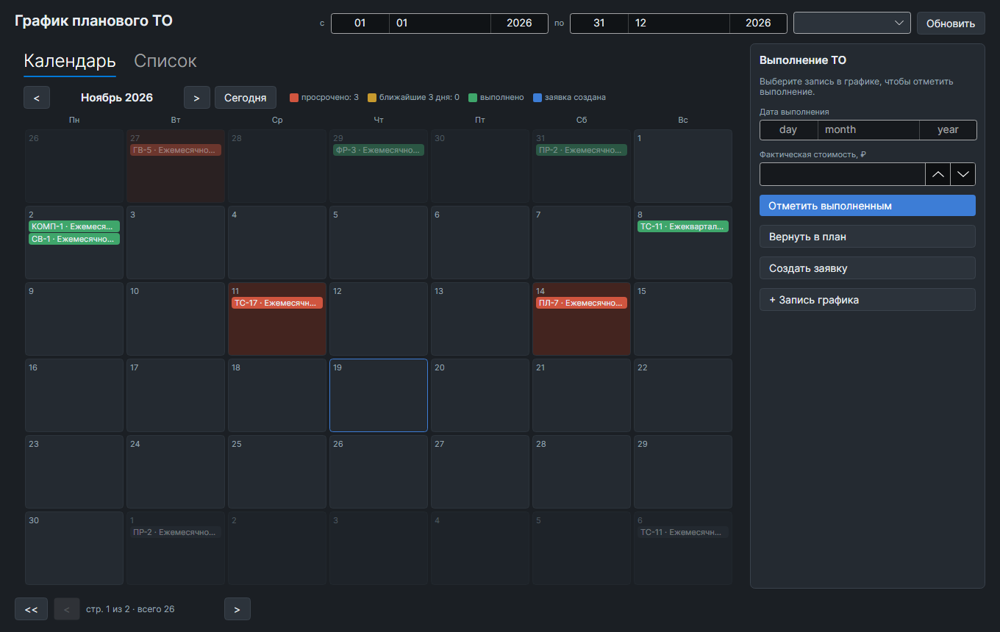

### 6.2. Список

Вкладка **Список** — та же информация таблицей. Выберите период двумя
полями даты и при необходимости фильтр статуса: «Запланировано»,
«Назначено», «Выполнено», «Просрочено».

Таблица показывает: оборудование, вид ТО, плановую дату, дату
выполнения, следующую плановую дату и статус.

Статусы выставляются автоматически:

- **Запланировано** — работа впереди;
- **Просрочено** — дата плановая, а работа не выполнена;
- **Назначено** — по записи создана плановая заявка;
- **Выполнено** — отработано, простой и стоимость зафиксированы.

### 6.3. Создание заявки из графика и новая запись

- **Создать заявку** — по выбранной записи сервер создаёт плановую заявку
  на это оборудование и вид ТО (`POST /api/schedule/{id}/create-order`),
  запись получает статус «Назначено». Повторно по той же записи заявку не
  создать — программа подскажет.
- **+ Запись графика** (руководитель, администратор) — форма: оборудование,
  вид ТО, плановая дата, примечание.

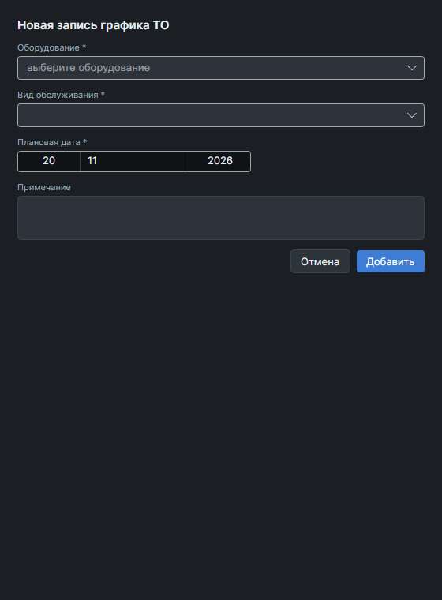

### 6.4. Отметка выполнения

1. Нажмите строку плановой записи — откроется панель «Выполнение ТО».
2. Укажите **дату выполнения**.
3. При желании впишите **фактическую стоимость** в рублях: это то, что
   реально потратили на работы и материалы. В поле можно ввести и
   `12500`, и `12500,50` — запятая как десятичный разделитель понимается.
4. Нажмите **Отметить выполненным**.

После этого программа сама показывает следующую плановую дату. Дату
следующего ТО рассчитывает сервер: она не вводится вручную, поэтому
ошибиться в ней нельзя.

Кнопка **Вернуть в план** отменяет отметку о выполнении. Она доступна
только пока запись ещё не выполнена и не связана с заявкой.

### 6.5. Что делать, если не получается

| Сообщение | Что означает |
|-----------|-------------|
| Запись уже выполнена | Повторная отметка не нужна — верните в план, если ошиблись |
| Дата выполнения раньше даты ввода оборудования в эксплуатацию | Проверьте год: техника введена в эксплуатацию позже, чем вы указали |
| Запись связана с заявкой | Сначала закройте связанную заявку, потом удаляйте запись |

---

## 7. Заявки на ремонт

Главный рабочий экран мастера. Заявка проходит путь:

```
Создана → Назначена → В работе → Выполнена → Закрыта
                         ↕
                 Ожидает материалов
Создана, Назначена, В работе → Отменена
```

«Выполнена» ставится, когда работа закончена. «Закрыта» — когда заявку
проверили и закрыли (раздел 7.7): после этого она больше не меняется. Перейти можно только по этим
стрелкам. Пропустить шаг или вернуться назад после закрытия нельзя —
сервер откажет и объяснит, какой переход запрещён.

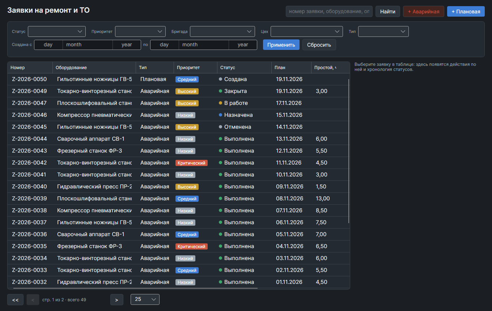

### 7.1. Поиск и фильтры

- **Поиск** — по номеру заявки, названию работ и оборудованию.
- **Статус**, **Приоритет**, **Бригада**, **Цех**, **Тип** (плановая,
  аварийная, инициативная) и период **Создана с … по** — фильтры;
  **Применить** запускает отбор, **Сбросить** очищает все фильтры.
- Под таблицей выбирается число строк на странице: 25, 50 или 100.
- Сортировка доступна по колонкам со значком ▲▼: номер, статус,
  приоритет, плановой дате, простою. Нажмите на заголовок колонки — данные
  пересортируются на сервере, второй раз по той же колонке меняет
  направление.

### 7.2. Создание заявки

1. Нажмите **+ Аварийная** (или **Ctrl+N**) либо **+ Плановая** —
   откроется форма новой заявки.
2. Проверьте **тип** и **приоритет**: для аварийной по умолчанию стоит
   «Критический».
3. Выберите оборудование, впишите тему, например «Стучит подшипник
   главного шпинделя», и опишите неисправность.
4. Для аварийной заявки обязательно укажите **причину неисправности**.
5. Укажите плановые даты начала и окончания и при желании бригаду.
6. Нажмите **Создать заявку**.

Перед отправкой форма проверяется функцией `validateWorkOrder` (та же, что
покрыта модульными тестами): оборудование и описание обязательны, начало
не может быть в прошлом, окончание — строго позже начала, у аварийной
заявки должна быть причина. Ошибки показываются списком в форме.

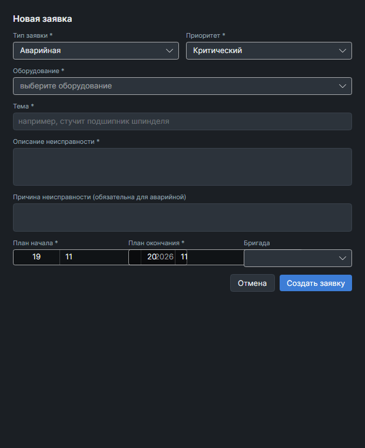

Номер заявки выдаёт сервер в формате `Z-год-номер`, например
`Z-2026-0048`. Номера выдаются строго по порядку и не повторяются, даже
если несколько мастеров создают заявки одновременно.

Если заявка создана для оборудования, выведенного из эксплуатации,
программа откажет — сначала верните оборудование в работу.

### 7.3. Назначение бригады

В карточке заявки выберите бригаду из списка и нажмите **Назначить**.

Проверки сервера:

- бригада должна быть активной;
- выбранный сотрудник должен состоять в этой бригаде;
- **у бригады не может быть двух заявок «В работе» одновременно.** Если
  бригада занята, программа сообщит об этом — сначала закройте текущую
  работу.

После назначения статус меняется на «Назначена».

### 7.4. Начало работы

Кнопка **Начать работу** переводит заявку в статус «В работе» и
записывает фактическое время начала. Сервер подставляет текущее время,
вручную его вводить не нужно. Оборудование при этом автоматически
получает статус «В ремонте».

### 7.5. Списание материалов

1. Выберите материал из списка.
2. Укажите количество — дробное значение разрешено (например, `0.5`).
3. Нажмите **Списать**.

Что произойдёт:

- количество вычтется из остатка на складе;
- стоимость пересчитается по текущей цене справочника;
- если указать материал повторно, количество **прибавится**, а не заменится.

Если остатка не хватает, программа откажет и покажет, сколько есть на
складе. Сначала оформите приход на складе (см. раздел 9), затем
повторите списание.

> **Важно.** Списать материал можно только на заявку в статусе
> «Назначена» или «В работе». На завершённую заявку списать нельзя.

### 7.6. Завершение заявки

1. Выберите заявку в статусе «В работе» и нажмите **Завершить (причина и
   материалы)…** — откроется окно завершения.
2. Впишите **причину неисправности** — что именно сломалось.
3. Добавьте израсходованные материалы: выберите позицию (в списке виден
   остаток), укажите количество и нажмите **Добавить**. Строку можно
   убрать кнопкой ✕. Итоговая стоимость считается сразу — функцией
   `calculateTotalMaterialCost`.
4. Нажмите **Завершить**.

Сервер списывает материалы в той же транзакции, что и завершение: если
какой-то позиции не хватает на складе, не выполнится ничего, и окно
покажет причину.

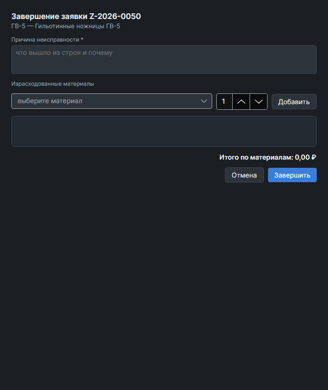

Заявка получает статус «Выполнена», а оборудование возвращается в статус
«В работе» (если по нему нет других заявок в работе).

Без причины заявку завершить нельзя: пустое поле сервер не примет, а
программа подскажет заранее.

После завершения программа показывает:

- фактическое время начала и окончания;
- **простой в часах** — его считает база данных, вручную он не меняется;
- все списанные материалы и итоговую стоимость.

### 7.7. Закрытие заявки

Выберите заявку в статусе «Выполнена» и нажмите **Закрыть заявку**.
Сервер пересчитает простой по фактическим датам и зафиксирует его, заявка
получит статус «Закрыта» и больше не изменяется: списать на неё материал
или поменять даты уже нельзя. Закрыть можно только выполненную заявку.

### 7.8. Хронология статусов

При выборе заявки справа появляется блок **Хронология статусов**: каждая
смена статуса («Статус: Создана → Назначена», «Статус: В работе →
Выполнена» и так далее) с датой, временем и автором, а также причина
неисправности и стоимость материалов. Записи берутся из журнала операций, который ведёт сервер, —
поэтому в истории видны и изменения, сделанные коллегами.

---

## 8. Бригады

Окно доступно руководителю и администратору.

**Реестр** показывает код, название, специализацию, число членов, заявок
в работе, завершённых заявок, суммарный простой и рейтинг.

**Рейтинг** — доля завершённых заявок от назначенных, в процентах:
зелёный бейдж — 80 % и выше, жёлтый — от 50 %, красный — ниже.

**Карточка бригады** открывается по клику на строку: состав с датой
вступления в бригаду и сводные цифры.

---

## 9. Материалы и запас ЗИП

Окно доступно руководителю и администратору.

**Справочник** показывает артикул, название, единицу измерения, цену,
остаток, минимальный запас, суммарное списание и признак дефицита.
Строка с пометкой «Дефицит» означает, что остаток упал ниже минимума —
такие позиции закупают в первую очередь.

**Приём и фильтры.** Поиск по артикулу или названию, переключатели
«только дефицитные» и «показывать отключённые», постраничная навигация.

**Приход на склад:**

1. Выберите материал в справочнике.
2. Укажите количество прихода.
3. Нажмите **Принять**.

Остаток увеличится, а значение в справочнике обновится. Количество можно
вводить дробным — например, `2.5` литра масла.

> **Важно.** Остаток на складе нельзя изменить «просто так», вписав число
> вручную. Остаток меняется только двумя операциями: приходом и списанием
> в заявку. Так история движений материала остаётся точной.

---

## 10. Отчёты

Окно доступно руководителю и администратору.

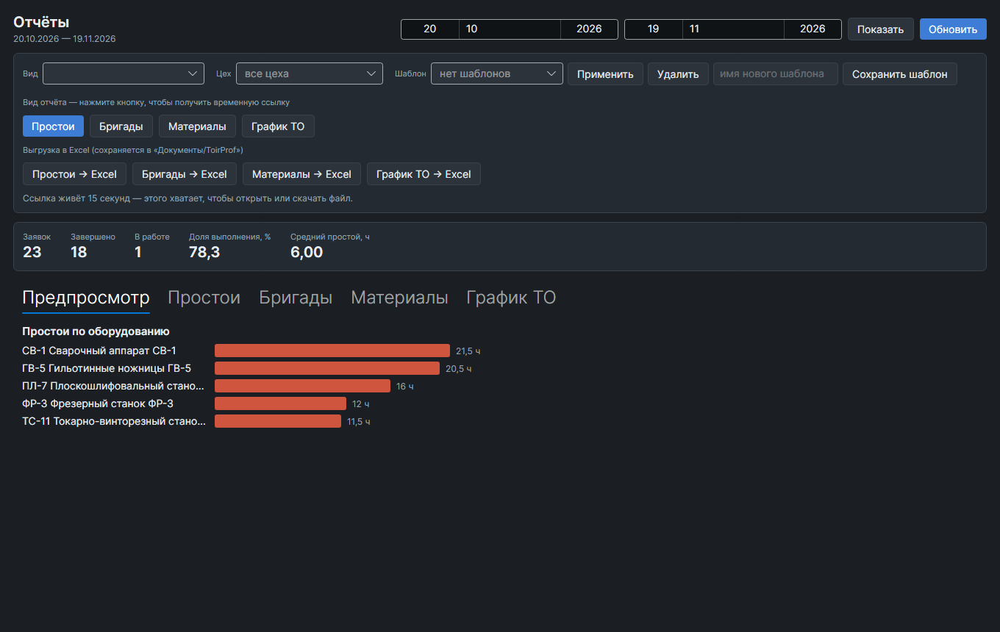

**Параметры.** Вверху выбираются **вид** отчёта, **цех** (или все цеха) и
период. Вкладка **Предпросмотр** показывает выбранный вид горизонтальной
диаграммой: простои по оборудованию, рейтинг бригад, расход материалов или
выполнение графика ТО по статусам.

**Шаблоны отчётов.** Впишите имя и нажмите **Сохранить шаблон** —
запомнятся вид, длина периода и цех. Шаблон выбирается из списка и
применяется кнопкой **Применить** (период отсчитывается от сегодняшнего
дня), **Удалить** убирает его. Шаблоны хранятся в настройках и доступны
после перезапуска.

**Что смотреть.** В окне четыре таблицы за выбранный период:

1. **Простои по оборудованию** — какие единицы простояли дольше всего.
2. **Бригады** — кто сколько выполнил, рейтинг, потраченные материалы.
3. **Материалы** — что и сколько списали за период.
4. **График ТО** — выполнение плановых работ по статусам.

Выберите период и нажмите **Обновить**.

**PDF-отчёт по временной ссылке.** Нажмите кнопку нужного отчёта:
**Простои**, **Бригады**, **Материалы** или **График ТО**. Программа
получит временную ссылку и покажет обратный отсчёт. Нажмите **Открыть
PDF** — файл откроется в браузере или программе просмотра PDF.

> **Важно.** Ссылка живёт **15 секунд** — это требование задания, а не
> ошибка. Не успели — нажмите кнопку отчёта ещё раз, ничего страшного.

**Выгрузка в Excel.** Кнопки **Простои → Excel**, **Бригады → Excel**,
**Материалы → Excel** и **График ТО → Excel** сохраняют таблицу за
выбранный период в файл `.xlsx`. Файлы складываются в папку
«Документы\ToirProf», полный путь программа показывает во всплывающем
сообщении. Числа в файле остаются числами — по ним работают сортировка
и формулы Excel.

---

## 11. Работа без сети

Если сервер недоступен, программа не показывает пустые таблицы, а
отдаёт **последние загруженные данные** и показывает в верхней панели
плашку «Нет связи».

Что происходит с операциями:

- операции, требующие связи (создать заявку, назначить бригаду,
  списать материал), **не выполняются** и не теряются молча — программа
  сообщает, что связь отсутствует;
- локально ведётся **очередь отложенных операций**, число ожидающих
  показано в верхней панели;
- как только связь вернётся, очередь отправляется автоматически с
  интервалом 15 секунд.

Если очередь не отправляется после восстановления связи, проверьте
сообщения журнала: они содержат код ответа сервера.

---

## 12. Где смотреть журнал и состояние клиента

Программа ведёт локальный журнал в текстовом виде.

| Что | Где лежит |
|-----|-----------|
| Журнал клиента | `%LOCALAPPDATA%/ToirProf/logs/client.log` |
| Токен и логин (только при «Запомнить меня») | `%LOCALAPPDATA%/ToirProf/session.json` |
| Настройки, размер окна, шаблоны отчётов | `%LOCALAPPDATA%/ToirProf/settings.json` |
| Очередь офлайн-операций | `%LOCALAPPDATA%/ToirProf/queue.json` |

В журнале каждая строка имеет вид `дата время уровень сообщение`. Уровни:
`INFO` — обычная работа, `WARN` — предупреждение, `ERROR` — ошибка.

Журнал автоматически ротируется: пять файлов по 512 КБ, старые
архивируются как `client.1.log`, `client.2.log` и так далее.

Сам журнал открывают текстовым редактором; кнопки просмотра журнала в
программе нет — журнал задумано читать при разборе проблем.

---

## 13. Типовые проблемы

| Симптом | Причина | Что делать |
|---------|---------|------------|
| Окно не открывается, в консоли ошибка | Не установлен .NET либо Avalonia | Установите .NET 10 из инфраструктурного листа площадки |
| «Нет связи с сервером» | Не запущен API или неверный адрес | Проверьте, что сервер запущен; адрес меняется переменной `TOIRPROF_API` |
| Данные не обновляются | Завис запрос | Нажмите **Обновить** (F5) |
| Не находится нужное окно в меню | Нет прав у роли | Обратитесь к администратору — за состав бригад и склад отвечает руководитель |
| Событие пропало после нажатия | Сервер вернул 409 | Прочитайте текст ошибки: он объясняет, какое ограничение нарушено |
| Простой показан как пусто | Заявка не завершена | Простой считается базой только после завершения |

---

## 14. Краткий чек-лист мастера

1. Войти под своим логином.
2. Открыть «Дашборд мастера», посмотреть период и долю аварийных.
3. Проверить «График ТО» — отметить просроченные работы.
4. Открыть «Оборудование цеха» — найти единицу, у которой меняли статус.
5. Открыть «Заявки» — взять заявку в работу, назначить бригаду, начать.
6. Списать использованные материалы.
7. Завершить заявку с причиной неисправности.
8. Убедиться, что в верхней панели нет плашки «Нет связи» и очередь пуста.

**ИИ в этой системе используется только для подготовки текстов
документации и презентации. Код, запросы к базе, триггеры и тесты
написаны без него.**